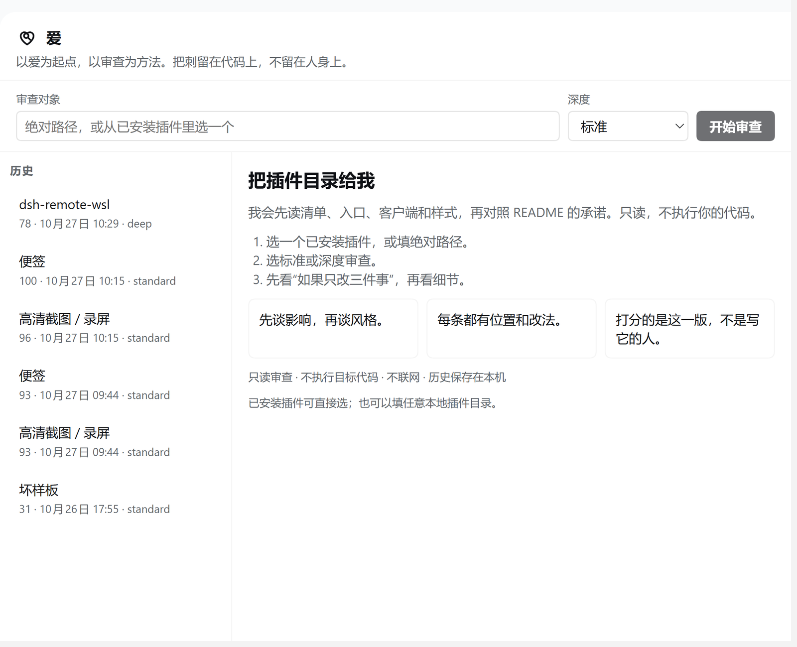
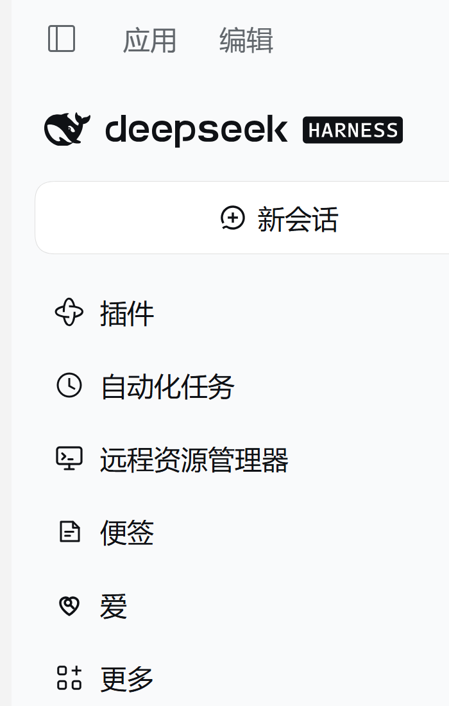
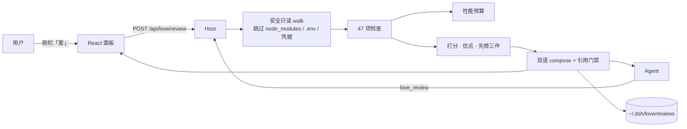

<p align="center">
  
</p>

<h1 align="center">爱 · Love</h1>

<p align="center"><em>以爱为起点，以审查为方法。把刺留在代码上，不留在人身上。</em></p>

<p align="center">
  <a href="#-四十七项检查"></a>
  
  
  
  
</p>

<p align="center">
  一个 DSH 插件：读第三方插件的<b>源代码</b>，从后端、前端、UI、UX、性能、AI 时代适配度六个维度，<br>
  指出这版代码会让<b>谁</b>在<b>哪一步</b>卡住——每条都带源码位置、用户影响、最小改法和依据类型。
</p>

<p align="center">
  
</p>

---

## 为什么需要它

插件「装了没反应」、点两下就晕、出错只显示 `Error: undefined`、删东西没有确认——这些不是审美问题，是**有人真的被卡住**。而作者往往看不到：代码在自己机器上一直是好的。

Love 做一件很窄的事：**把源码读一遍，然后按"用户会在哪里疼"排序讲给你听**。它不猜运行时，不冒充性能实验室，也不把没读过的论文当依据。

名字里的「爱」是出发点，不是修辞：认真看到别人的劳动，才谈得上批评。所以每条发现都配一句「怎么改」，结尾固定一句话——

> 把刺留在代码上，不留在人身上。

## 快速开始

**安装**（二选一）

1. **DSH 里装**：打开「插件」设置 → 添加插件 → 选本地目录，或直接填 GitHub 地址 `mozhuanzuojing/dsh-plugin-love`。
2. **写进 profile**：在 `~/.dsh/profiles/<name>/package.json` 的依赖里加
   `"dsh-plugin-love": "github:mozhuanzuojing/dsh-plugin-love"`，把 `dsh-plugin-love` 加进 `dsh.profile.bundles`，再 `pnpm install`。

装好后侧栏出现「爱」：

<p align="center">
  
</p>

**审一个插件**：选一个已安装插件，或填插件目录的绝对路径 → 选「标准」或「深度」→ 开始审查。

**或者直接让 Agent 干**：

```text
用 love_review 审一下 D:\path\to\plugin，中文，深度，重点看 UI/UX 和性能。
```

| 参数 | 取值 | 说明 |
|---|---|---|
| `target` | 绝对路径 / 已安装包名 | 装过的插件可以直接报名字，不用写路径 |
| `lang` | `zh` / `en` | 报告语言 |
| `depth` | `quick` / `standard` / `deep` | `deep` 额外跑 10 条 UI/UX/性能深检 |
| `focus` | 六维子集 | 只关心某几维时收窄范围（结构维度不参与筛选） |

## 报告长什么样

一次标准审查的输出分三层，**先结论、再证据、最后才细节**：

1. **如果只改三件事** —— 按"用户疼感 × 维度权重"排序，最多三条。
2. **六维分数** + **性能预算表**（包体 / 内联资源 / 同步 IO / 轮询 / 未取消 fetch / 串行 await / 布局动画）。
3. **逐条发现**：`[P1] 清单/补丁/客户端入口对不上` + 证据位置 + 用户看到什么 + 最小改法 + 依据（`read` 引用或「工程判断」）。

外加两个容易被忽略的区块：

- **需要你亲眼看一眼**：焦点陷阱、真实窄屏、动效舒适度这类静态分析测不准的东西，明说交给人。
- **覆盖与跳过**：读了哪些文件、哪些被预算跳过、哪些语言不支持、哪些指标没测（Lighthouse / 内存 / 真实网络计时一律标注 not run）。

## 四十七项检查

| 维度 | 条数 | 看什么 |
|---|---:|---|
| 后端 | 5 | 空 catch 吞错、生命周期没人收、命令注入、硬编码密钥、硬编码绝对路径 |
| 前端 | 7 | `dangerouslySetInnerHTML`、effect 没 cleanup、直接摸 DOM、文案硬编码、不可访问控件、iframe、重复打包 React |
| UI | 9 | 状态色当正文、字面量对比度、焦点可见性、目标尺寸 < 24px、`prefers-reduced-motion`、字号、CLS、双滚动、只靠颜色表意 |
| UX | 9 | 破坏性操作无确认、原始错误直出、无空态/加载态、无键盘替代、无 Esc、无重试、复制/保存无反馈、长任务无进度、未保存提醒 |
| 性能 | 9 | 包体预算、内联资源、热路径同步 IO、轮询过快、fetch 不可取消、串行 await 循环、布局属性动画、`font-display`、长列表不虚拟化 |
| AI 时代 | 5 | 工具描述是否有边界、破坏性工具是否要确认、有无降级路径、上下文是否膨胀、外部内容是否标成「不可信数据」 |
| 结构 | 3 | package/patch/client 入口是否对齐、图标（可选）、中英字典是否配对 |

**47 条 = core 37（默认）+ deep 10（深度模式）。** 每条都有稳定的 check id、严重度、置信度和「怎么改」，报告里可逐条对应。

## 打分

```
罚分  P0 35 · P1 18 · P2 8 · P3 3
     × 置信度（高 1.0 / 中 0.7 / 低 0.4）
     × 同规则多处系数（最多 1.3）

维度分 = max(0, 100 − Σ罚分)
总分   = Σ(维度分 × 权重)   后端 12% · 前端 13% · UI 20% · UX 20% · 性能 20% · AI 15%
```

标准分和深度分**不直接比较**；分数只评这一版代码，不评作者。P0 的意思是"会直接伤到用户或数据"，所以一个 P0 就能把总分拉到"先别急着让人用"。

## 引用制度（先读后引）

| 状态 | 含义 | 能进哪里 |
|---|---|---|
| `read` | 真打开过，读到具体段落，记录逐字摘录 + 定位 + URL + 日期 | 可绑定到规则，出现在发现里 |
| `metadata` | 只核验了标题/作者/年份/DOI | 只能进附录 |
| `candidate` | 没核验 | 不出现 |

`basis: experience` 的规则**不挂任何引用**，报告里标成「工程判断」。性能阈值是**产品预算**（可配置），不冒充论文结论。阅读记录在 [`verify/reading-notes.md`](verify/reading-notes.md)。

## 架构



- **Host**：一个工具（`love_review`）+ 两条路由（`/api/love/state`、`/api/love/review`），同一份 `src/review.ts` 编排。
- **Client**：React 面板，注册 `sidebar.panellist`（id `love`）与 `main`（key `love`）。React 由宿主注入，插件不打包第二份。
- **构建**：esbuild 两路产物——`lib/index.js`（ESM，Host）与 `client.js`（IIFE，经 `window.__ModuleLoader__` 加载）。
- **运行时依赖：0。** 装的是构建产物，不是一坨依赖树。

## 安全边界

- **只读**：不 `import`/`require`/执行目标代码，不写目标目录，不联网，不复制整包源码。
- 不跟随符号链接；跳过 `node_modules`、`.env*`、凭据、私钥、`.map`、锁文件。
- 证据片段最多 3 行 / 2000 字符；密钥自动掩码（`sk-l…cdef`）；路径把 home 换成 `~`。
- 历史只落 `~/.dsh/love/reviews/`，最多 50 条；面板与工具同源同鉴权，不另起服务器。

## 已知限制

- **静态审查**：没有运行时性能、Lighthouse、真实网络计时、内存测量。报告里的 `notRun` 会明说。
- 只覆盖 JS / TS / JSON / CSS / HTML / YAML / Markdown / SVG；其他语言列进 `skipped`。
- 启发式规则带 confidence，`experience` 规则是工程判断，不是标准或论文结论。
- 视觉层级、焦点陷阱、真实 320px 窄屏、动效舒适度**必须人眼看**——报告单列「需要你亲眼看一眼」。
- 不做 GitHub URL 自动 clone：先 clone，再填本地路径。
- 预算跳过的大文件（> 512KB）不读内容，只在预算表里计入体积。

## 开发

```bash
pnpm install
pnpm typecheck     # tsc --noEmit
pnpm test          # Vitest
pnpm build         # esbuild → lib/index.js + client.js
pnpm verify        # 三件套一起跑
```

`pnpm verify` 是唯一门禁：类型检查 + 测试 + 构建，任何一步失败就停。

```text
src/index.ts        Host 入口：love_review 工具 + 两条路由
src/review.ts       编排：resolve → walk → analyze → checks → score → compose → persist
src/scan.ts         目标解析（包名 / 绝对路径）、安全 walk、文件角色判定
src/analyze.ts      清单、locale、图标、性能预算统计
src/checks.ts       47 条检查目录
src/score.ts        打分、优点、人工检查项
src/compose.ts      双语 + Markdown 组装
src/store.ts        ~/.dsh/love 历史
src/knowledge.ts    引用注册表（read / metadata / candidate 三层）
src/client/         React 面板、locale 字典、token-only 样式
scripts/            build.ts / verify.ts
tests/              Vitest（28 个用例，含真实 React renderToString）
test/fixtures/      bad-plugin（47 项全埋雷）与 good-plugin（干净对照）
verify/             REPORT.md（实现与验证报告）、reading-notes.md、tool-e2e.ts、recheck-targets.ts
```

验证不是自觉，是留痕：[`verify/REPORT.md`](verify/REPORT.md) 里记了每个根因、真实命令、退出码和前后对比。这个插件也用自己审自己——**100 / 100，0 findings**。

## 设计取舍

- **不做"评分网站"**：没有榜单、没有对比、没有公开羞辱。只有这一版代码和它的用户。
- **误报比漏报贵**：报告里的建议会被照着改，所以启发式先在真实第三方插件上跑过——`verify/recheck-targets.ts` 就是这个校准回路。真实案例：曾经把「纯 Host 插件没有图标」判成 P1「装了没反应」，把 bundle 故意插入宿主模块判成「改名残留」，两条都来自真实插件，fixtures 造不出来。
- **结构维度不参与筛选**：`focus` 只收六个维度；清单/图标这类结构问题永远全量检查。

## License

MIT © 磨砖做镜

<p align="center">
  <br>
  <a href="https://github.com/deepseek-ai/deepseek-harness"></a>
</p>
